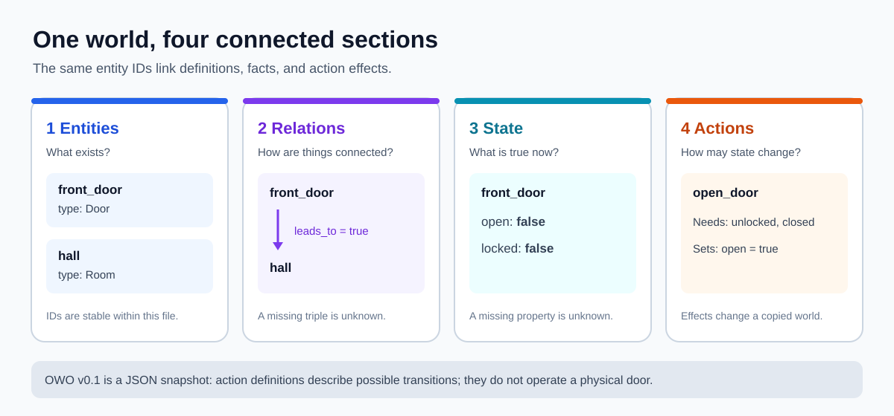

# Open World Ontology (OWO)

OWO v0.1 is a small, open JSON protocol for entities, directed relations,
dynamic state, and grounded actions. The Python package is a reference SDK and
CLI. Missing facts have the third truth value `unknown`, so an action runs only
when its precondition is explicitly `true`.



The [illustrated Door walkthrough](examples/door/README.md) shows three world
snapshots and the different answers that two conforming agents should reach.

For other domains, explore the [example gallery and practical uses](examples/README.md):
server maintenance, support tickets, and single-item inventory reservations.

## Install and try the Door example

Python 3.9 or newer is required.

```sh
python -m pip install '.[test]'
owo validate examples/door/world.json
owo evaluate examples/door/world.json open_door
owo apply examples/door/world.json open_door -o opened.json
owo evaluate opened.json close_door
python -m pytest
```

`python -m owo` provides the same CLI when the console script is unavailable.
Pass `-` as the input path to read standard input; `apply` writes to standard
output by default. The SDK can be used directly:

```python
import json
from owo import Truth, apply_action, evaluate_action, validate_world

with open("examples/door/world.json", encoding="utf-8") as stream:
    world = json.load(stream)
validate_world(world)
assert evaluate_action(world, "open_door") is Truth.TRUE
opened = apply_action(world, "open_door")  # original world is unchanged
```

## Protocol documents

- [RFC-0001: Core world model](docs/rfc/RFC-0001-core-model.md)
- [RFC-0002: Open-world state and three-valued truth](docs/rfc/RFC-0002-state-and-truth.md)
- [RFC-0003: Grounded actions and effects](docs/rfc/RFC-0003-actions.md)
- [RFC-0004: Validation, compatibility, and CLI](docs/rfc/RFC-0004-conformance.md)
- [Draft 2020-12 JSON Schema](src/owo/schemas/owo-v0.1.schema.json)
- [Door example](examples/door/world.json)
- [Illustrated Door walkthrough](examples/door/README.md)
- [Example gallery and practical uses](examples/README.md)
- [Conformance tests](tests/test_conformance.py)
- [How to contribute](CONTRIBUTING.md)

This release intentionally covers literal entities and actions in one world
document. It does not define inference, parameterized actions, transport, or
persistent storage.
