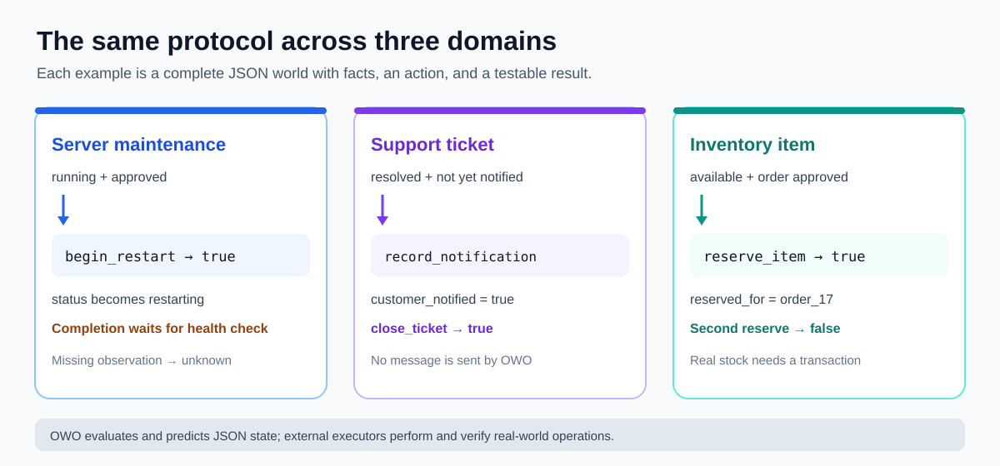
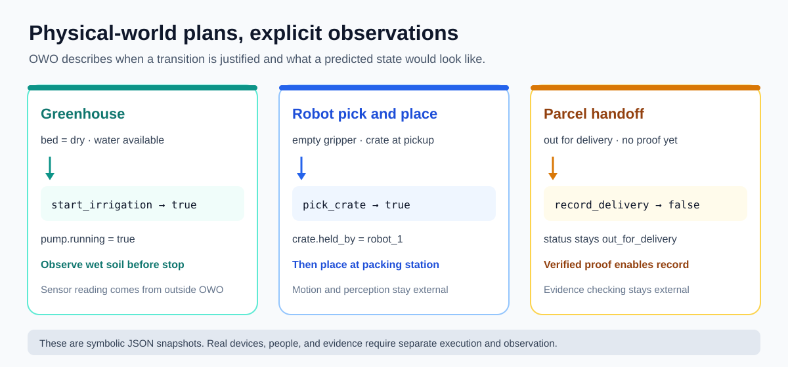
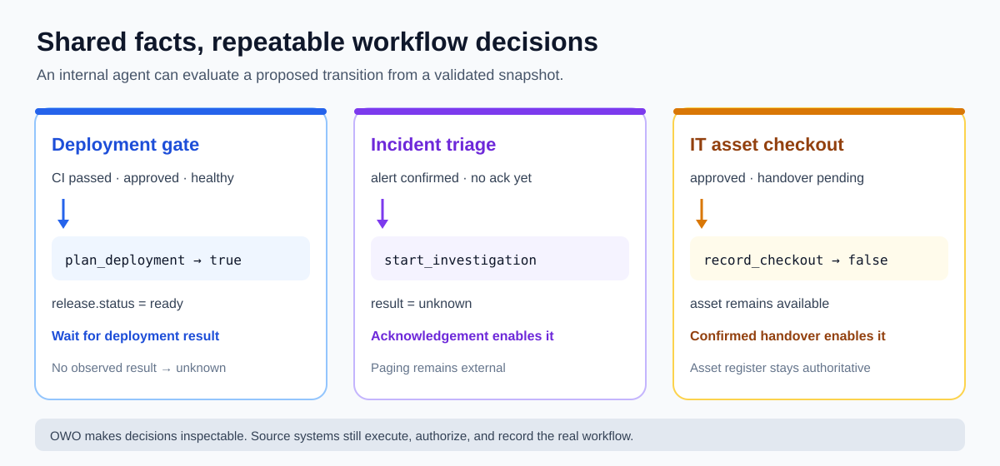

# Example gallery and practical uses

Each directory contains complete OWO v0.1 JSON snapshots that you can validate,
evaluate, and apply with the CLI. Start with the [Door walkthrough](door/README.md)
for the three truth values, then try a workflow closer to your own domain.

| Example | Question answered | What the action changes |
|---|---|---|
| [Door](door/README.md) | Is the door explicitly closed and unlocked? | `open` becomes `true` |
| [Server maintenance](server-maintenance/README.md) | Can maintenance begin, and has a health check been observed? | A server's planned `status` |
| [Support ticket](support-ticket/README.md) | Is a resolved customer ticket ready to close? | Notification record, then ticket `status` |
| [Inventory](inventory/README.md) | Is one item available for an approved order? | Reservation fields for that item |

## Physical-world examples

These cases use observed facts and symbolic transitions. They do not control
devices or certify that a physical action succeeded.

| Example | Question answered | What the action changes |
|---|---|---|
| [Greenhouse irrigation](greenhouse/README.md) | Is the bed dry and the pump ready? Has a wet reading been observed before stopping? | Pump `running` state |
| [Robot pick and place](robot-pick-place/README.md) | Can the assigned robot pick and then place a crate? | Gripper, location, and holder state |
| [Parcel handoff](parcel-handoff/README.md) | Is there explicit delivery evidence for the addressed recipient? | Parcel `status` |

## Company-internal workflows

The [internal workflow guide](company-internal/README.md) includes a runnable
record adapter and shows how to map facts from existing company systems.

| Example | Question answered | What the action changes |
|---|---|---|
| [Deployment gate](deployment-gate/README.md) | Are test, approval, and health facts present before planning a release? | Release `status`; waits for observed deployment outcome |
| [Incident triage](incident-triage/README.md) | Has the on-call team acknowledged a confirmed alert? | Incident `status` |
| [IT asset checkout](it-asset-checkout/README.md) | Was an approved laptop handover confirmed? | Asset assignment and request `status` |

## Where this MVP fits

- **Agent and simulator fixtures:** Give separate implementations the same
  world snapshot and compare their `true`/`false`/`unknown` decisions and
  resulting state. This makes action semantics testable across codebases.
- **Workflow previews:** Check whether a proposed transition has enough known
  facts before writing to a real system. An `unknown` result identifies a
  missing observation instead of guessing that it is false.
- **Shared interchange format:** Exchange a small set of entities, relations,
  state facts, and grounded actions between a planner, a UI, and a test tool.
  The JSON Schema and conformance suite make structural and semantic mistakes
  visible early.
- **Documentation and review:** Keep example worlds in Git alongside their
  expected decisions so reviewers can inspect what an action means.

## A safe integration loop

1. Read facts from the real system and construct a valid OWO snapshot.
2. Call `validate_world` and `evaluate_action` to inspect the proposed action.
3. If the result is `true`, let your **separate** executor decide whether and
   how to perform the real operation. OWO does not grant permissions.
4. Observe the real outcome and construct a fresh snapshot. Use `apply_action`
   only for a predicted or simulated state transition, not as proof of success.

OWO v0.1 does not call external APIs, operate hardware, send notifications,
reserve stock in a database, perform arithmetic, update relations, or
coordinate concurrent actors. For irreversible or shared-resource operations,
use the transaction, authorization, safety, and observation mechanisms of the
real system.
