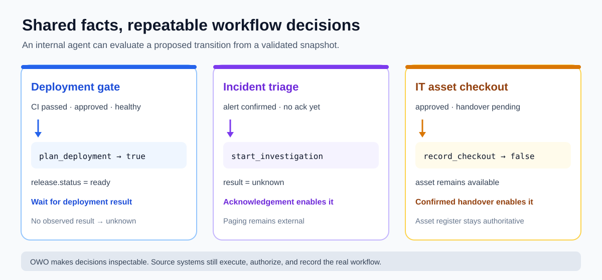

# Company-internal workflow examples

These examples show where OWO v0.1 can help an internal agent or application
reach a repeatable decision from facts collected across existing systems.
They use synthetic IDs and contain no company data.



| Workflow | Source facts to map | OWO question |
|---|---|---|
| [Deployment gate](../deployment-gate/README.md) | Release tracker, CI result, change approval, service health | Is the release ready to plan? Was deployment success observed? |
| [Incident triage](../incident-triage/README.md) | Alert, service ownership, on-call acknowledgement | Is there enough evidence to mark investigation started? |
| [IT asset checkout](../it-asset-checkout/README.md) | Asset register, approved request, handover confirmation | Can the checkout be recorded? |

## Try a small record adapter

[`build_deployment_world.py`](build_deployment_world.py) reads the synthetic
[`deployment-records.json`](fixtures/deployment-records.json) export and maps
its fields into an OWO world. It deliberately omits fields absent from the
source, so missing evidence evaluates to `unknown`.

```sh
python examples/company-internal/build_deployment_world.py \
  examples/company-internal/fixtures/deployment-records.json \
  > /tmp/owo-from-records.json
owo validate /tmp/owo-from-records.json
owo evaluate /tmp/owo-from-records.json plan_deployment
```

The final command returns `"result": "true"`. Remove `approval_received`
from the fixture's `change` object in a private copy, rebuild the world, and
the same action returns `unknown`. Replace the local JSON export with reads
from your internal systems when integrating this pattern.

## Use the result in an internal application

1. Fetch current facts from systems of record and build a fresh world snapshot.
2. Validate the snapshot. Evaluate an action to explain which facts permit or
   block the proposed transition.
3. Let the existing workflow or executor perform any real change under its
   own authorization and transaction rules.
4. Observe the outcome and create a new snapshot. `apply_action` is useful for
   previews and tests, not proof that the operation completed.

The v0.1 model is grounded to literal IDs and uses exact equality tests. It
does not query internal tools, resolve live identities, enforce permissions,
lock shared resources, or persist history. Keep real internal records in your
private systems; the repository fixtures are synthetic examples.
