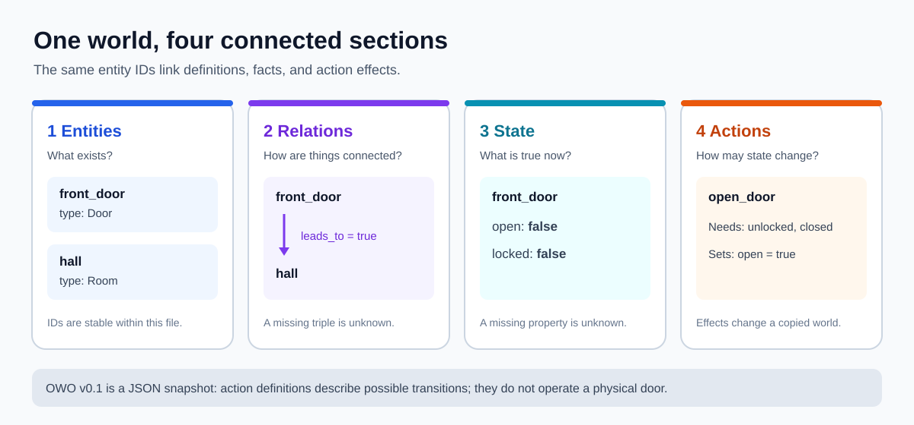
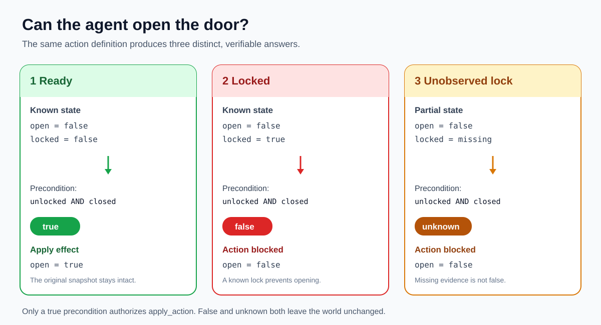
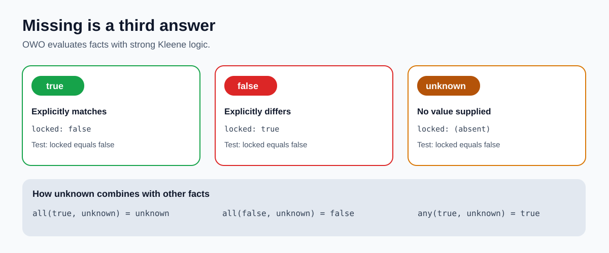

# Door: an illustrated OWO v0.1 example

This example uses one `Door` entity, one `Room` entity, and a directed
`leads_to` relation. The `open_door` action requires the door to be explicitly
unlocked and closed. When both checks are true, its effect sets `open` to
`true` in a new world snapshot.



## Three snapshots, one action definition

The three JSON files differ only in the `locked` fact. All are valid OWO v0.1
worlds. The action definition is identical in each file.



| World file | `open` | `locked` | `open_door` result | Can apply? |
|---|---|---|---|---|
| [`world.json`](world.json) | `false` | `false` | `true` | Yes; `open` becomes `true` |
| [`locked.json`](locked.json) | `false` | `true` | `false` | No |
| [`unknown-lock.json`](unknown-lock.json) | `false` | absent | `unknown` | No |

Run the example from the repository root after installing the package:

```sh
python -m pip install '.[test]'
owo validate examples/door/world.json
owo evaluate examples/door/world.json open_door
owo evaluate examples/door/locked.json open_door
owo evaluate examples/door/unknown-lock.json open_door
owo apply examples/door/world.json open_door -o opened.json
owo evaluate opened.json close_door
```

The three `owo evaluate` calls return `"result": "true"`, `"result":
"false"`, and `"result": "unknown"`, respectively. The final call returns
`"result": "true"` because the applied effect has opened the door. Applying
`open_door` to either blocked world exits with status 2 and writes a diagnostic
instead of an updated world.

## Why missing is different from false



In `unknown-lock.json`, the `locked` property is omitted. The world does not
assert that the door is locked or unlocked. The condition `locked equals
false` therefore evaluates to `unknown`, and the action cannot run. In
`locked.json`, the world explicitly says `locked: true`, so the same condition
is `false`. This distinction lets independent agents avoid guessing from
missing evidence.

`null` is different again: a present property with JSON value `null` is a
known value. The [state and truth RFC](../../docs/rfc/RFC-0002-state-and-truth.md)
defines the complete evaluation rules.

This is a symbolic state transition. It does not physically open a door or
grant an agent permission to operate hardware.
